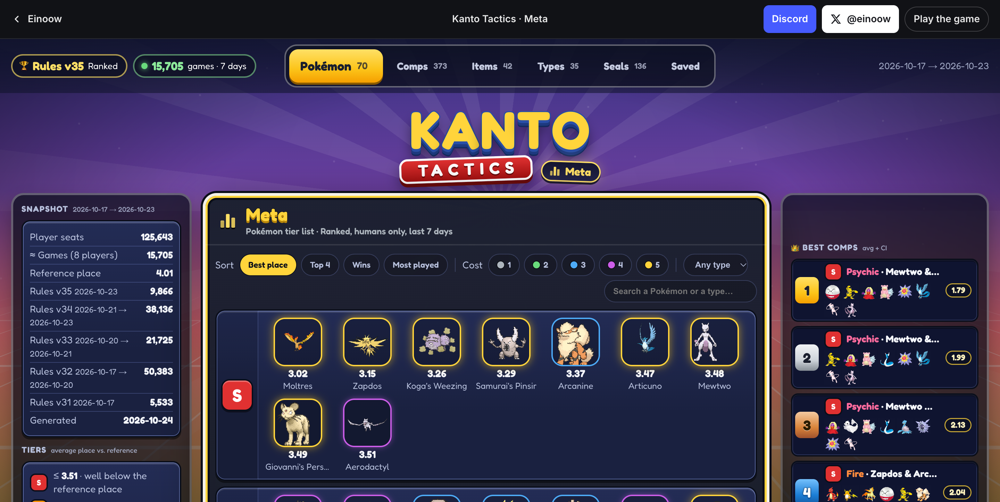
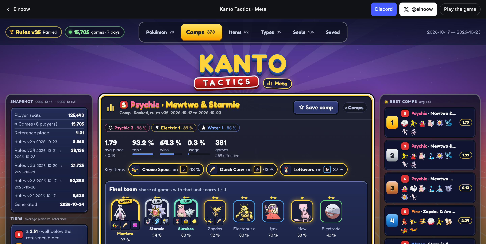

# Kanto Tactics Meta

**Live: [kanto-tactics-meta.vercel.app](https://kanto-tactics-meta.vercel.app/)**

Tier lists and comp guides for [Kanto Tactics](https://einoow.com/kanto-tactics) Ranked, built on the game's public
[Meta API](https://einoow.com/api/meta/kanto/) and styled like the in-game Meta panel and lobby. Updated daily.

[](https://nextjs.org)
[](https://react.dev)
[](https://www.typescriptlang.org)
[](https://kanto-tactics-meta.vercel.app/)





## What it shows

- **Pokémon, items, types**: S to D tier lists from the week's average place, sortable and filterable, each with its own page (and a modal when you click from a list): items players put on it, best comps with it, synergy thresholds.
- **Comps**: every comp of the last 7 days with **carry, sub and tank** marked, key items, final team with item shares, placement on the hex board from real games, stage-by-stage guide and variants. Filters are URL links; tier S is the default view.
- **Game plan** on every comp page (Early → Mid → Final, like TFT sites): what players who ended on the comp had at the end of stages 3 and 4, what they kept, what they sold, the level to reach. And one **best setup** per comp: every final unit once on its most frequent hex.
- **Early game** page: the units the good comps field at the end of stages 3 and 4, how well those comps finish, and whether the unit stays or gets sold; each links to the final comps that start with it.
- **Seals**: catalogue of the game's augments by round, rarity and category (the API publishes no stats for them).
- **Saved comps**: a cookie, no account.
- Side panels like the lobby: snapshot of the window, tier legend, shop odds, best and most played comps of the week.

## Stack

Next.js 16 (App Router, Cache Components, Partial Prefetching), React 19, TypeScript, Tailwind CSS v4, Vitest, pnpm.
Styling is Tailwind utilities only: the game's palette, faces, shadows and keyframes live in `@theme` in `globals.css`,
recurring class strings in `src/components/ui/styles.ts`; there are no CSS modules.
No database and nothing fetched at request time: the site is built from a committed copy of the API (`data/snapshot`),
refreshed by a daily GitHub Action whose commit triggers the build. Every page is a static file; a data refresh is a deploy.

| Route | Rendering | Why |
| --- | --- | --- |
| `/` Pokémon tier list | Static shell + request-time list (`searchParams`) → client takes over | The first paint matches the shared URL; sorting and filtering 70 rows is instant in the browser and mirrored to the URL. |
| `/pokemon/[line]`, `/items/[id]`, `/types/[slug]` | SSG via `generateStaticParams`, in every language | Fully known sets; prerendered pages with `generateMetadata` and OG images. |
| `@modal/(.)pokemon/[line]` and friends | Intercepting + parallel route | The same Server Component as the page, shown as a `<dialog>` on client navigation; shareable URL, Back closes it. |
| `/comps` | Static shell + request-time list from `searchParams` | Filters are plain links, no client JS; 833 comps are too many to ship to the browser. The list is a filter and a sort over the in-memory model, not a cache entry per combination. |
| `/comps/[slug]` | SSG for reliable comps, on demand for the rest (then kept until the next deploy) | The Save button reads its cookie in the browser, so the page is fully static. |
| `/favorites` | Request-time (cookie) inside the static shell | Per-visitor. |
| `sitemap.xml`, `robots.txt`, `manifest.webmanifest`, `opengraph-image` | Metadata routes | SEO and social cards. |

- `src/server/api.ts` reads the committed API files (`data/snapshot/{meta,data,lang.<locale>}.json`).
- `src/server/meta.ts` builds the normalised model once per language per process (tiers, carry roles, slugs, typical placement) and exposes `React.cache`d selectors so `generateMetadata` and the page share one read.
- `src/server/actions.ts` holds the Server Actions (`toggleFavorite`, `clearFavorites`).
- `src/app/[locale]/layout.tsx` is the document only: Next ships the root layout a second time in every page's payload (around the 404 fallback), so the lobby chrome lives in `(lobby)/layout.tsx`.
- `src/lib` is pure logic (tiers, carry, placement geometry) covered by Vitest.

## Develop

```sh
pnpm install
pnpm dev          # http://localhost:3000
pnpm test         # vitest
pnpm lint && pnpm typecheck
pnpm build && pnpm start
pnpm sprites      # download missing sprites into public/ after a game update
pnpm snapshot     # refresh data/snapshot from the API (what the daily workflow does)
```

Copy `.env.example` to `.env.local`: `NEXT_PUBLIC_SITE_URL` sets the canonical origin outside Vercel.

## Data refresh, and if the API goes down

`data/snapshot/` is a committed copy of the API files (`meta.json`, `data.json`, `lang.en.json`, `lang.fr.json`).
A GitHub Action (`.github/workflows/snapshot.yml`) refreshes it daily after the API's 03:40 UTC regeneration and
commits when it changed; that commit is what deploys the day's site. Run `pnpm snapshot` to do it by hand. When
the API stops answering, nothing is committed, the site keeps its last build, and a yellow banner says since when
once the data is more than 36 hours old. Pages are static files on the CDN: no ISR reads or writes, no function
runs for a page view (only `/comps` with filters, `/favorites`, the Save action and the OG images run at request time).

## How the numbers are read

- **Pokémon, items, types** use the game's tiers: average place against the week's reference place. The API stops at C; **D** is this site's split, mirroring S (reference + 0.5). A Pokémon's tier is the average of every board it ends on, in any comp, so a unit can be B on its own and still sit in most tier S comps; its page says in how many.
- **Comps** are graded on the pessimistic average (avg + 95 % CI): S ≤ ref − 0.8, A ≤ ref − 0.15, B ≤ ref + 0.6, C ≤ ref + 1.2, D above. The "Best" sort uses the same number. Comps under 30 effective games only have their 4 core units in the API and are hidden by default.
- **Carry** = the unit with the most offensive item share (Attack, Sp. Atk, speed, crit, Energy, drain), **sub** = the second when geared at least 40 % as often, **tank** = the most defensive one (HP, defenses, shields). See `src/lib/carry.ts`.
- **Placement**: the API gives a board for comps with 50+ boards; below that the site shows where each unit usually stands in the comps that do have one.

## Credits

Unofficial fan page, not affiliated with Nintendo, Creatures or GAME FREAK. Game, data, sprites and icons belong
to [Kanto Tactics](https://einoow.com/kanto-tactics) by Einoow. The API is public and read-only: poll it at most
once an hour and cache it on your side.
